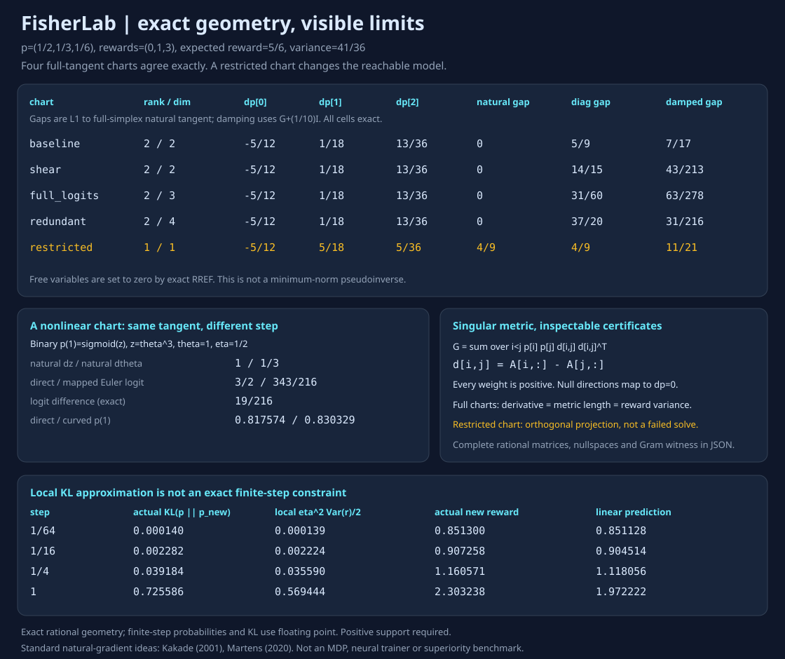
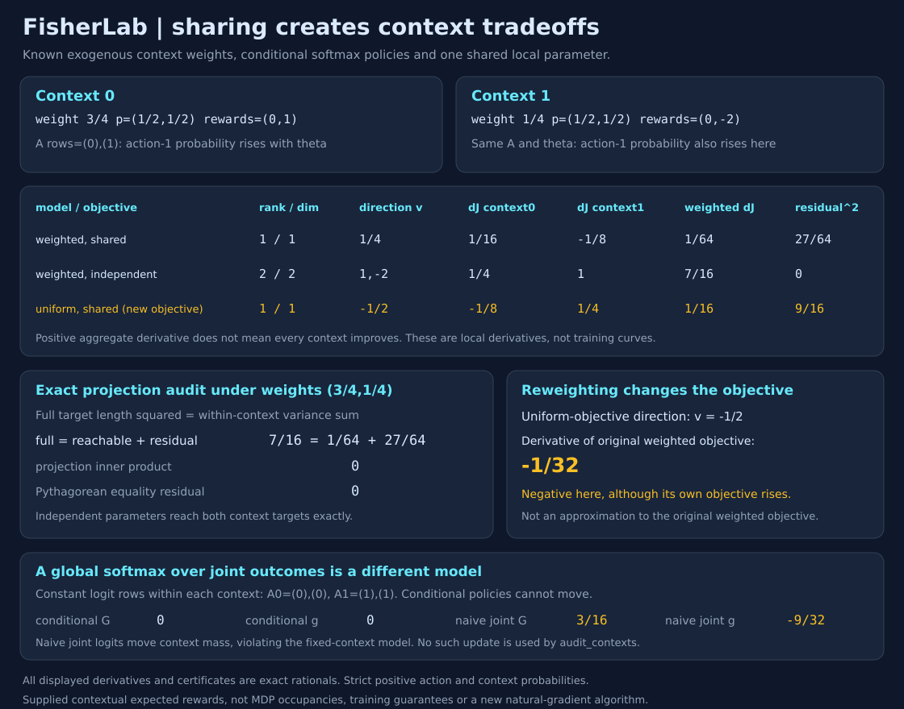

# FisherLab

FisherLab computes natural-gradient directions for supplied categorical action probabilities, rewards and coordinate matrices. It returns every Fisher matrix, singular-system solve and nullspace direction using exact rational arithmetic. It runs offline in Python 3.10+ without runtime dependencies.

Use [the single-context calculation](DESIGN.md) to compare coordinate charts, or [the shared-context calculation](CONTEXTS.md) to inspect how one parameter direction trades off fixed contexts.

Natural gradients are often described as "parameterization invariant." This project makes the qualifiers executable: full categorical Fisher solves agree in probability space, diagonal approximations and coordinate damping need not, restricted models have fewer reachable tangents, and nonlinear finite Euler steps need not agree even when their initial tangents do.



## Run

```sh
python -m fisherlab demo > report.json
python -m fisherlab audit examples/input.json > custom.json
python -m unittest discover -s tests -v
python examples/render_audit.py --check
pip install .
fisherlab demo
```

The demo asserts both agreement and counterexamples. The committed [full report](examples/demo.json), [strict input](examples/input.json), [proof and scope](DESIGN.md) and byte-reproducible SVG make the numbers inspectable. 45 tests pass. CI runs Python 3.10-3.13, both CLI paths, SVG regeneration and installed-wheel comparisons outside the source checkout.

## Exact fixture, not a training benchmark

Three actions have `p=(1/2,1/3,1/6)` and rewards `(0,1,3)`. Expected reward is `5/6`, reward variance `41/36`. Four full-tangent charts give exactly the same natural probability tangent `(-5/12,1/18,13/36)`:

| Logit-coordinate chart | Rank / parameters | Natural L1 gap | Diagonal L1 gap | Damped L1 gap |
|---|---:|---:|---:|---:|
| Baseline: rows `(1,0),(0,1),(0,0)` | 2 / 2 | 0 | 5/9 | 7/17 |
| Shear: rows `(1,2),(0,1),(0,0)` | 2 / 2 | 0 | 14/15 | 43/213 |
| Full logits: identity | 2 / 3 | 0 | 31/60 | 63/278 |
| Redundant: rows `(1,2,1,0),(0,1,0,1),(0,0,0,0)` | 2 / 4 | 0 | 37/20 | 31/216 |
| Restricted: rows `(1),(0),(0)` | 1 / 1 | 4/9 | 4/9 | 11/21 |

Gaps are L1 distances to the full-simplex natural tangent, not performance scores. Damping is `G+(1/10)I` in each chart. Diagonal means `diag(G)` with zero-gradient/zero-diagonal coordinates set to zero. Ordinary gradient results are also in the report. These particular differences demonstrate non-invariance, not universal rankings of approximation methods.

The restricted chart's tangent `(-5/12,5/18,5/36)` is the exact Fisher-metric projection into its smaller reachable space. It is not a failed solver or a reparameterization of the full simplex.

### A finite-step trap

A separate binary model has `p(action1)=sigmoid(z)`, rewards `(0,1)` and local coordinate `z=theta^3` at `theta=1>0`. Natural directions are `dz=1` and `dtheta=1/3`, so the initial mapped logit tangent agrees exactly. At step `eta=1/2`, Euler updates give logit `3/2` directly versus `343/216` in the curved chart, an exact difference `19/216`. Updated action-1 probabilities are approximately `0.817574` versus `0.830329`.

For the three-action fixture, step 1 along the exact logit natural direction has actual `KL(p_old || p_new)=0.725586`, while its local quadratic prediction is `41/72=0.569444`. The linear reward prediction is `71/36=1.972222` versus actual `2.303238`. Local quantities are not exact finite-step constraints or promises. The probabilities and KL in these finite-step controls use floating point; geometry, logit differences and local predictions use exact rational arithmetic.

## API and witness

```python
from fisherlab import audit, encode
report = audit(
    ['1/2', '1/3', '1/6'], [0, 1, 3],
    [[1, 2], [0, 1], [0, 0]], damping='1/10'
)
assert report['gram_agrees']
assert report['full_simplex_reachable']
assert report['natural']['full_simplex_gap_l1'] == 0
json_ready = encode(report)  # fractions become strings; counts/bools stay typed
```

A coordinate matrix has one row per action. It is a local Jacobian from parameter directions to logits, evaluated at the supplied probability distribution. Any positive supplied distribution can be the chart's origin by choosing a logit offset; no original parameter value is inferred.

Output includes the logit Fisher, probability Jacobian, pullback Fisher, per-action score rows, two independent-form Gram reconstructions, positive weighted pairwise outer-product certificate, gradient, full RREF augmented matrix, pivot/free columns, all nullspace directions, solve residual and induced null tangents. Each natural/ordinary/diagonal/damped direction includes parameter/logit/probability vectors, objective derivative, Fisher length, probability-space length and L1 gap.

**The exact RREF representative sets free variables to zero. It is not a Moore-Penrose pseudoinverse or minimum-Euclidean-norm solution.** Null representatives are interchangeable only in their induced probability tangent. For full charts, natural objective derivative and both metric lengths equal reward variance. Restricted charts report rank and projection gap explicitly.

Inputs: 2-8 strictly positive rational probabilities summing exactly to 1, aligned rational rewards, 1-12 coordinate columns and positive rational damping. Python accepts integers, `Fraction` or rational/decimal strings; JSON uses integers/strings. Floats and booleans are rejected. Rational inputs are capped at 128 numerator/denominator bits and strings at 100 characters. CLI requires exactly `version:1, probabilities, rewards, coordinates, damping`, rejects duplicate/unknown fields and files over 100KB. Invalid CLI calls exit 2 without a JSON result. Exact arithmetic is bounded small-model work, not scalable linear algebra.

## Verification and limits

- The original 25 behavior tests, retained in the current suite of 45, cover independently computed finite-difference reward/probability derivatives, every entry of a KL Hessian, exact closed forms, 16 seeded chart configurations up to 8 actions/12 parameters, gauge/reward-shift and ordering invariance, frozen/restricted/overcomplete charts, complete singular-system residual/null witnesses, sum-of-squares quadratic certificates, finite-step controls, strict API/CLI errors, immutability and global RNG isolation.
- Three original SVG tests verify all 60 table cells and positions, exact nonlinear logit controls, complete compressed report metadata, hidden witness tampering and byte regeneration.
- Full-support categorical expected reward only. There are no MDP transitions, estimated occupancies, learned critics, sampled Fisher/gradient noise, policy training, neural networks, line search, trust-region enforcement or convergence/optimizer-superiority benchmark. Boundary probabilities are rejected, not regularized silently.
- Singular solves are consistent because the reward gradient is in the pullback Fisher's range. The PSD certificate uses positive action probabilities. Damping is deliberately coordinate-identity damping, not an invariantly transformed regularizer. The input Jacobian alone does not specify any nonlinear finite update; that control is separately defined.

## Shared-context extension



`audit_contexts` and the `context-demo` / `contexts INPUT.json` CLI paths aggregate exact Fisher and reward-gradient systems across 1-6 fixed contexts sharing parameters. [Derivation, model and witness](CONTEXTS.md), [full report](examples/context-demo.json) and [caller input](examples/contexts-input.json).

With context frequencies `(3/4,1/4)`, equal binary action probabilities and rewards `(0,1)` / `(0,-2)`, a shared parameter has natural direction `1/4`. Total reward derivative is positive `1/64`, but the second context's derivative is negative `-1/8`. The full-conditional target has exact squared length `7/16 = 1/64 + 27/64` (reachable plus metric-orthogonal residual). Independent context parameters reach both targets and have zero residual; they are a larger model, not a training benchmark.

Replacing frequencies with uniform weights changes the objective. Its natural direction `-1/2` has derivative `-1/32` when evaluated on the original weighted objective. A separate context-gauge control is frozen under conditional normalization but has spurious nonzero Fisher/gradient if naively modeled as a global joint softmax. Full context-tagged PSD, RREF/nullspace, per-context derivative and projection witnesses make both distinctions inspectable.

Fourteen shared-context behavior tests and three SVG tests bring the full suite to 45, retaining the original 28, including independent weighted reward/KL finite differences, centered joint-score reconstruction, exact projection/null certificates, strict CLI and conditional-versus-joint controls. Context weights are positive exogenous constants, not MDP occupancies or policy-dependent frequencies. Local derivative agreement and aggregate improvement do not promise every context or finite step improves.

## Attribution

Standard natural-gradient/Fisher ideas, not a new algorithm or a reproduction of published training experiments:

- Sham Kakade, [A Natural Policy Gradient (2001)](https://proceedings.neurips.cc/paper/2001/file/4b86abe48d358ecf194c56c69108433e-Paper.pdf), Section 2: score Fisher and natural-gradient motivation.
- James Martens, [New Insights and Perspectives on the Natural Gradient Method (2020)](https://jmlr.org/papers/volume21/17-678/17-678.pdf), Sections 5/9: Fisher and pullback; Section 10: damping; Section 12: infinitesimal versus finite-step parameterization invariance.

Original small-model implementation, exact witnesses, controls and tests. MIT license.
